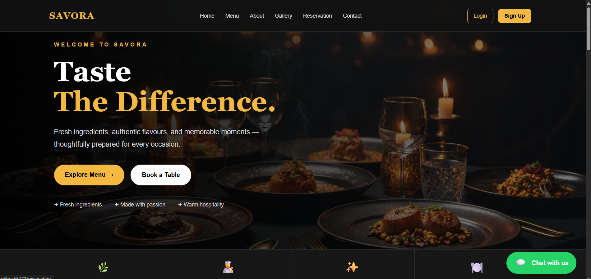
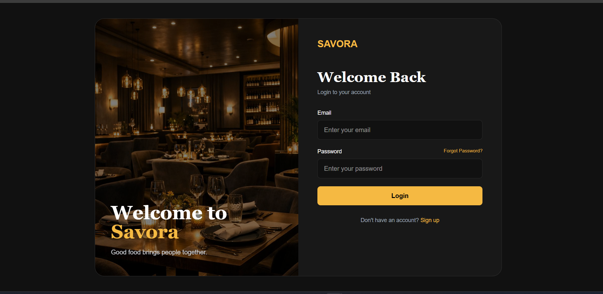
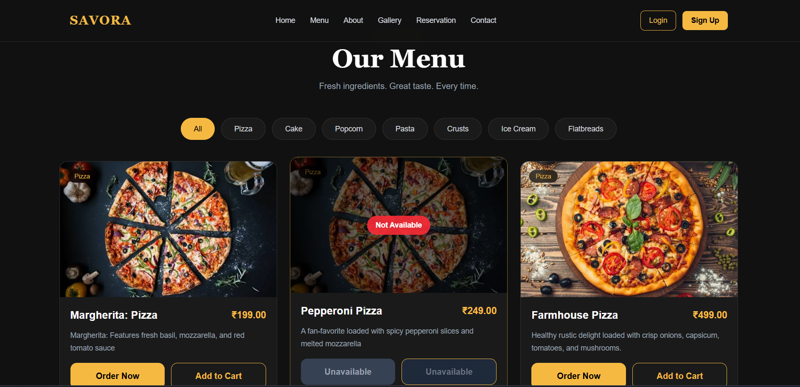

# 🍽️ SAVORA — Restaurant Management System

SAVORA is a full-stack restaurant web application built with **React, Spring Boot, and MySQL**. It provides a web interface for customers to explore restaurant menus, manage their accounts, place food orders, and access their dashboard.

## 📸 Screenshots

### Home Page


### Login Page


### Menu Page


### User Dashboard


### Admin Dashboard


> Replace these screenshot files with actual screenshots from your application.

## ✨ Features

- User registration and login
- JWT-based authentication, if configured
- Restaurant menu and food item browsing
- Shopping cart and checkout
- Online payment integration, if configured
- Customer dashboard
- Order management
- Table reservations, if configured
- Admin dashboard and menu management, if configured
- Responsive interface using Tailwind CSS

## 🛠️ Technologies Used

### Frontend
- React
- Vite
- Tailwind CSS
- JavaScript
- Axios
- React Router

### Backend
- Java
- Spring Boot
- Spring Data JPA
- Spring Security
- JWT authentication, if configured
- Maven

### Database
- MySQL

## 📁 Project Structure

```text
SavoraRestaurant/
├── restro/                   # Spring Boot backend
│   ├── src/
│   ├── pom.xml
│   └── mvnw
│
├── savora-restaurant/        # React frontend
│   ├── public/
│   ├── src/
│   ├── package.json
│   └── vite.config.js
│
├── docs/
│   └── screenshots/
│       ├── home.png
│       ├── login.png
│       ├── menu.png
│       ├── user-dashboard.png
│       └── admin-dashboard.png
│
├── .gitignore
└── README.md
```

## ✅ Prerequisites

Install the following software before running the project:

1. **Git** — to clone the repository.
2. **Java JDK** — a version compatible with the backend's `pom.xml`.
3. **Node.js and npm** — use a current supported Node.js LTS version.
4. **MySQL Server** — for storing application data.
5. **VS Code** or another Java/React IDE.

Check your installations:

```bash
git --version
java -version
node -v
npm -v
```

## 🚀 Installation and Setup

### Step 1: Clone the Repository

```bash
git clone https://github.com/akgitram/SavoraRestaurant.git
cd SavoraRestaurant
```

### Step 2: Configure MySQL

Start your MySQL server and create the database used by the backend.

For example:

```sql
CREATE DATABASE savora_db;
```

Use your existing database name instead if your project already uses one.

### Step 3: Configure the Backend

Open the backend folder:

```bash
cd restro
```

Configure your database connection in:

`src/main/resources/application.properties`

Example configuration:

```properties
spring.datasource.url=${DB_URL:jdbc:mysql://localhost:3306/savora_db}
spring.datasource.username=${DB_USERNAME:root}
spring.datasource.password=${DB_PASSWORD}

spring.jpa.hibernate.ddl-auto=update
spring.jpa.show-sql=true
```

Adjust these properties to match your existing backend configuration. For example, if MySQL runs on port `3307`, change the URL accordingly.

Set your database password and any JWT, mail, or payment credentials through environment variables or another secure configuration method. Never commit real credentials to GitHub.

If your backend uses Razorpay, configure the required Razorpay test credentials before testing online payments.

### Step 4: Run the Spring Boot Backend

From the `restro` folder, run:

**Windows PowerShell:**

```powershell
.\mvnw.cmd spring-boot:run
```

Alternatively, if Maven is installed:

```bash
mvn spring-boot:run
```

The backend will normally run at:

```text
http://localhost:8080
```

Keep this terminal open.

### Step 5: Install Frontend Dependencies

Open a second terminal at the repository root:

```bash
cd savora-restaurant
npm install
```

### Step 6: Configure the Frontend

Check the frontend API configuration and make sure it points to your local backend while running locally.

For example:

```javascript
const API_URL = "http://localhost:8080";
```

If your project uses environment variables, configure the appropriate Vite variable instead. Use a public `VITE_` variable only for non-secret values; never put private API secrets in frontend code.

### Step 7: Run the React Frontend

From the `savora-restaurant` folder:

```bash
npm run dev
```

Open the local URL printed in the terminal, normally:

```text
http://localhost:5173
```

Your frontend should now communicate with the Spring Boot backend.

## 🧪 Testing the Application

1. Start MySQL.
2. Start the Spring Boot backend.
3. Start the React frontend.
4. Open the frontend in your browser.
5. Test registration and login.
6. Test menu loading and cart functionality.
7. Test orders, reservations, and payments if those features are configured.

If the frontend cannot access the backend, check the API URL, Spring Security rules, CORS configuration, and database connection.

## 🔐 Security Notes

- Never commit database passwords, JWT signing secrets, Gmail app passwords, or Razorpay secret keys.
- Configure private credentials on each developer's machine or in the deployment environment.
- Use test payment credentials while developing.
- Do not use production credentials in a public repository.

## 👨‍💻 Author

**Akram Ali**

GitHub: [@akgitram](https://github.com/akgitram)

## 📄 License

Add a license file if you intend to grant others permission to reuse, modify, and distribute this project. Otherwise, do not claim that the project has an open-source license.

---

Built with React, Spring Boot, and MySQL.
